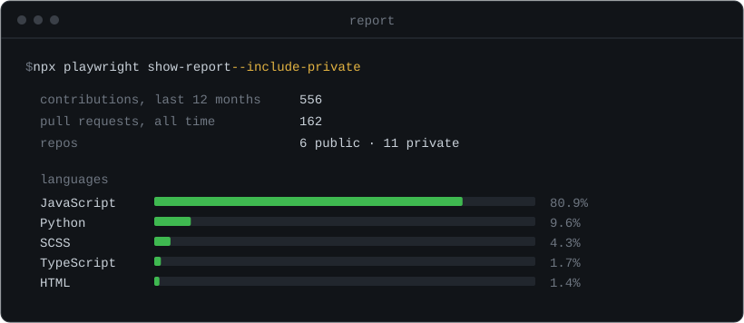

<p align="center">
  
</p>

<p align="center">
  <b>Brizzy</b> · QA Automation Engineer<br>
  <sub><i>I break things for a living, then write the steps to reproduce.</i></sub>
</p>

<br>

### `describe('me')`

I test software for a job and build small, slightly unhinged tools for fun.
Most of my day is Playwright, a few flaky selectors, and the quiet joy of a red test turning green for the right reason.

Somewhere along the way I noticed I'd rather automate a boring task than do it twice, so now I have a bot for my timesheets, a bot for my tweets, and a webcam that turns my friends into other people. The common thread: if it's repetitive, it's a test case waiting to happen.

Right now I'm learning how APIs are actually built, because I've spent long enough on the other side of the request.

<br>

### `describe('stack')`

<table>
  <tr>
    <td valign="top" width="33%">
      <sub>TESTING</sub><br><br>
      <code>Playwright</code><br>
      <code>Cypress</code><br>
      <code>Postman</code><br>
      <code>REST Assured</code>
    </td>
    <td valign="top" width="33%">
      <sub>BUILDING</sub><br><br>
      <code>JavaScript</code> <code>TypeScript</code><br>
      <code>Python</code><br>
      <code>React</code> <code>Vite</code> <code>Tailwind</code><br>
      <code>Node</code> <code>Express</code> <code>SQLite</code>
    </td>
    <td valign="top" width="33%">
      <sub>GLUE</sub><br><br>
      <code>Slack API</code><br>
      <code>Clockify API</code><br>
      <code>Gemini API</code><br>
      <code>OAuth 2.0</code> <code>Electron</code>
    </td>
  </tr>
</table>

<br>

### `describe('things I built')`

| | | |
|---|---|---|
| **[Timesheet Bot](https://github.com/Brizzy00/Timesheet-Bot)** | A Slack bot that fills in my Clockify hours. Gemini writes the descriptions; I just approve them. | `Python` `Slack` `Gemini` |
| **Cadence** | Schedules posts across several X accounts, so I can post on Tuesday while asleep on Tuesday. | `Node` `SQLite` `React` `OAuth 2.0` |
| **Friend Cam** | A real-time webcam filter that swaps faces live. Built for the group chat, also lives on desktop. | `React` `Electron` |
| **Gemini Task Bot** | Playwright keeps a page alive, asks Gemini what to do, then fills in the radios and sliders itself. | `Playwright` `Gemini` |
| **Money Tracker** | A budget app that never leaves your browser. No account, no server, no one watching. | `React` `Tailwind` `localStorage` |
| **AFTERHOURS** | A dark, noir-styled venue directory. Mostly an excuse to get the typography right. | `React` `Tailwind v4` `React Router` |
| **[API Testing Portfolio](https://github.com/Brizzy00/api-testing-portfolio)** | Functional, negative, boundary, auth and performance tests in Postman. Where the API learning started. | `Postman` |

<sub>Unlinked ones are private for now. Ask and I'll walk you through them.</sub>

<br>

### `report`




<br>

### `describe('currently learning')`

```ts
test('APIs, from the server side', async () => {
  // spent years sending requests. now building the thing that answers them.
  expect(curiosity).toBeGreaterThan(fear);
});
```

<br>

### `test.skip()`

```ts
test.skip('filling in timesheets by hand');      // automated. see above.
test.skip('scheduling posts at 9am manually');   // also automated.
test.fixme('my sleep schedule');                  // known issue, no ETA
```

<br>

### `afterAll()`

<p>
  <a href="https://brizzy00.github.io">portfolio</a> &nbsp;·&nbsp;
  <a href="https://linkedin.com/in/samuel-ebisemiju">linkedin</a> &nbsp;·&nbsp;
  <a href="mailto:ebisemijusamuel1@gmail.com">email</a>
</p>

<br>

<p align="center">
  
</p>
